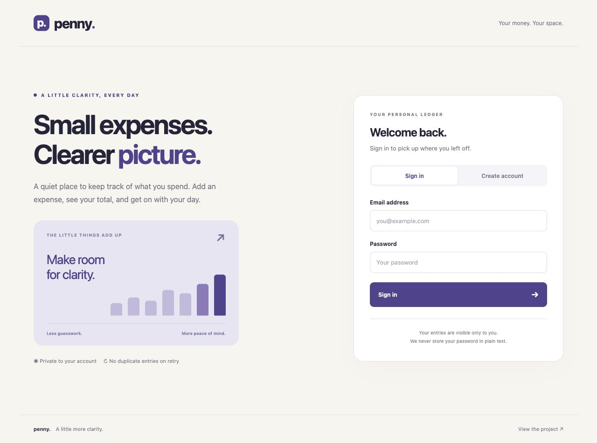
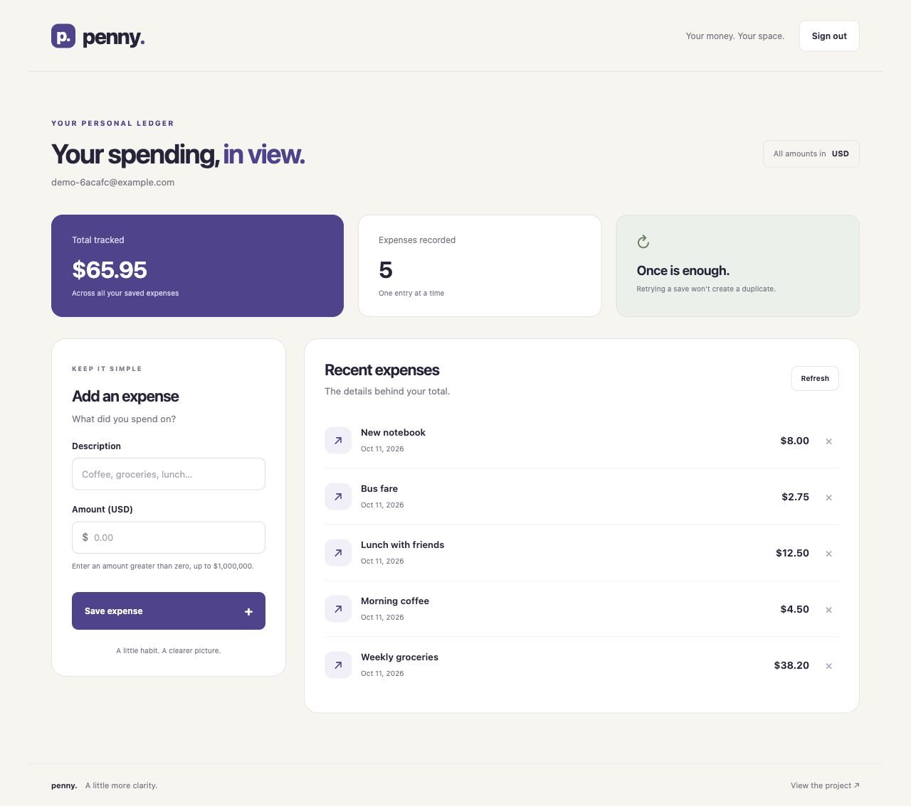
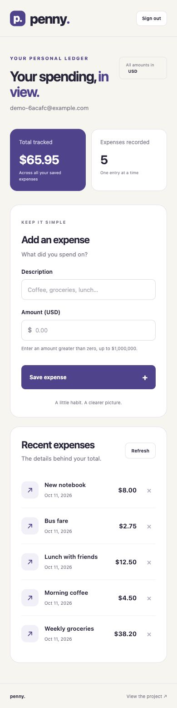

**[Open the live demo →](https://expense-tracker-88pa.onrender.com/)**

# Penny — private expense tracker

A responsive web application and HTTP API for accounts and private USD expense records. The homepage provides signup, login, adding expenses, private totals, pagination, deletion with confirmation, and sign-out. It includes real sign-in, ownership checks on every expense query, durable retry protection, field-specific errors, cursor pagination, and persistent database storage. SQLite supports local development; PostgreSQL supports Render Free hosting without a paid disk.

Repository: https://github.com/saikatdas47/expense-tracker

Open the homepage to use the frontend. The Render service has DATABASE_URL configured and uses a free Render PostgreSQL database in the same Oregon region. The database dashboard lists expiry as November 10, 2026. The SQLite fallback is disposable on Render Free.

## Run locally

Prerequisites: **Node.js 24.x**, its bundled **npm 11.x**, Git, and curl. No database account or environment variables are needed for the local SQLite setup. A clean checkout needs internet access for `npm ci`.

```sh
git clone https://github.com/saikatdas47/expense-tracker.git
cd expense-tracker
npm ci
npm start
```

Leave that terminal running. In a second terminal:

```sh
curl -i http://localhost:3003/health
```

Expected: **200 OK**, with `{"ok":true,"database":"sqlite"}`. Open `http://localhost:3003/` to register and use the frontend. A blank database is created automatically; no seed or migration command is needed. For a first write, use the signup and expense examples below. An existing demo email returns 409; choose another email or sign in instead.

Default URL: `http://localhost:3003`. `PORT` controls the port; `DB_PATH` controls the database file, defaulting to `./data/expenses.db`. Tables and the database directory are created at startup. Run `npm test` to verify authentication, ownership, concurrent retries, restart persistence, validation, pagination, logout, and exact session expiry.

## Environment variables

The application reads the process environment; it does **not** automatically load a `.env` file. Export variables in your terminal or set them in your hosting dashboard. Never commit credential values.

| Variable | Source / example | Required? Can startup proceed without it? |
| --- | --- | --- |
| `PORT` | Render supplies it; locally choose an unused port, e.g. `3003` | Optional; defaults to `3003`. Integer 0–65535; 0 selects a random port. Invalid values stop startup. |
| `DB_PATH` | Choose a writable local filename, e.g. `./data/expenses.db` | Optional; defaults to that filename. Ignored when DATABASE_URL is set. Unwritable paths stop SQLite startup. |
| `DATABASE_URL` | Render Postgres dashboard → Internal Database URL; locally a PostgreSQL connection URL you administer | Optional for startup using SQLite; required for durable storage on Render Free. A supplied URL must connect successfully or startup fails. |
| `NODE_VERSION` | Set `24` in Render's dashboard | Hosting runtime selection only; the app does not read it. Locally install Node 24.x yourself. |
| `TEST_DATABASE_URL` | Connection URL for a disposable PostgreSQL test database; tested with PostgreSQL 15.18 | Tests only; optional. Startup is unaffected. Without it, the PostgreSQL test is skipped. The test database user needs permission to create/drop an isolated schema. |

For example, `PORT=3004 DB_PATH=./data/demo.db npm start` uses another local port and database. No JWT secret, SMTP credential, or external cache is needed.

## Deploy for free using only Render

Connect this repository to a **Free Web Service**, choose Node and branch main, and leave Root Directory empty.

| Setting | Value |
| --- | --- |
| Build Command | `npm ci --omit=dev` |
| Start Command | `npm start` |
| Health Check Path | `/health` |
| Environment: NODE_VERSION | `24` |
| Environment: DATABASE_URL | Your Render PostgreSQL **Internal Database URL** |

In Render, create **New → Postgres**, choose **Free**, and use the same region as the web service. Copy its Internal Database URL into the web service's DATABASE_URL environment variable. Keep this credential out of Git, screenshots, logs, and chat. Render supplies PORT. Remove the old DB_PATH setting; it is not used when DATABASE_URL is set. No JWT secret or paid disk is required. Existing SQLite accounts do not migrate automatically: sign up again after switching to PostgreSQL.

**The free PostgreSQL database expires after 30 days.** This is an assessment/demo setup, not indefinite hosting. Render Free web services also spin down after inactivity and can take approximately a minute to wake up. Keep a database export before expiry if you need the demo data later. No paid plan or automatic upgrade is required by this project. See [Render Free documentation](https://render.com/docs/free).

If DATABASE_URL is not set, the service falls back to SQLite at `./data/expenses.db`. That makes the frontend immediately usable on an existing free service, but data, accounts, sessions and retry receipts are lost on service restart, spin-down or redeployment. Connecting PostgreSQL is necessary for durable retry behavior on this host.

A Dockerfile is included for other hosts. With PostgreSQL, set DATABASE_URL; with SQLite, mount a persistent local volume at `/app/data`.

## Data model

| Table | Purpose |
| --- | --- |
| users | Unique lowercase email, salted scrypt password hash, creation time |
| sessions | SHA-256 hash of a random bearer token, user foreign key, expiry |
| expenses | User foreign key, title, positive integer amount in cents, creation time |
| idempotency | Composite primary key `(user_id, key)`, normalized request hash, original response JSON |

SQLite foreign keys are enabled on every connection; PostgreSQL enforces them through the schema constraints. Money uses integer cents. Each expense belongs to exactly one account. The `(user_id, id DESC)` index supports private cursor-paginated lists.

## API

All JSON request examples use `Content-Type: application/json`. Authenticated requests use `Authorization: Bearer <token>`. Every endpoint can return **500** for an unexpected internal failure, with the diagnostic error shape below.

| Method / path | Input | Success output | Other statuses |
| --- | --- | --- | --- |
| POST `/auth/signup` | JSON `{email,password}` | **201** `{user:{id,email},token,expiresAt}` | **400** body/email/password invalid; **409** email already registered; **429** authentication rate limit |
| POST `/auth/login` | JSON `{email,password}` | **200** same session shape as signup | **400** input invalid; **401** credentials incorrect; **429** authentication rate limit |
| POST `/auth/logout` | Bearer token; no body required | **200** `{ok:true}`; session revoked | **401** token invalid |
| GET `/expenses` | Bearer token; optional `limit` (1–100, default 20), `before` (positive integer cursor) | **200** `{items:[expense],nextCursor,summary:{count,totalCents}}` | **400** query invalid; **401** token invalid |
| POST `/expenses` | Bearer token, `Idempotency-Key`; JSON `{title,amountCents}` | **201** `{expense}`; identical status and body on replay | **400** body/title/amount/key invalid; **401** token invalid; **409** same key with different data |
| GET `/expenses/:id` | Bearer token; positive integer id | **200** `{expense}` | **400** id invalid; **401** token invalid; **404** missing or unowned expense |
| DELETE `/expenses/:id` | Bearer token; positive integer id; no body required | **200** `{ok:true}` | **400** id invalid; **401** token invalid; **404** missing or unowned expense |
| GET `/health` | None | **200** `{ok:true,database:"sqlite"}` or `"postgres"` | No input validation; readiness is established at startup, not a fresh database probe per request |
| GET `/` | None | **200** HTML frontend | No request body |
| GET `/styles.css` | None | **200** CSS text | No request body |
| GET `/app.js` | None | **200** JavaScript text | No request body |

An `expense` contains `id`, `title`, `amountCents`, and `createdAt` (UTC ISO timestamp). IDs are numbers; amounts are integer USD cents. `summary` covers all this user's saved expenses, not just the current page. `nextCursor` is the last returned ID when another page exists, otherwise null. Use it as `before` for the next request. `expiresAt` is a Unix timestamp in milliseconds; the token is valid only before it.

Unknown routes return **404**. Unsupported methods on `/expenses`, `/expenses/:id` and `/auth/logout` return **405** after authentication (or **401** without valid credentials). Unsupported methods on public/auth routes fall through to **404**, rather than 405. The service does not use 403 for ownership failures: it returns 404 to avoid revealing whether another user's row exists.

Expense endpoints and logout require `Authorization: Bearer <token>`. Missing, malformed, expired, and revoked credentials return **401** with `WWW-Authenticate: Bearer`. Using another valid user's token does not grant access: detail reads and deletes include `user_id` in their database predicates and return **404** for unowned rows. Lists include only the authenticated user's rows. A caller-supplied `userId` is ignored; ownership comes exclusively from the verified session.

Signup/login require an email address of at most 254 characters and a password between 8 and 128 characters. Passwords are salted and hashed with scrypt; plaintext passwords are never stored. Session tokens contain 32 random bytes, expire after seven days, and only their SHA-256 hashes are stored. Signup and login share a per-process limit of 30 attempts per remote IP per minute; 429 responses include `Retry-After`. Behind a proxy this may group clients under the proxy IP, so use provider-level rate limits for larger deployments.

## Example requests

Register a disposable account using your own password:

```sh
curl -i -H 'Content-Type: application/json' \
  -d '{"email":"your-demo@example.com","password":"choose-your-own-password"}' \
  http://localhost:3003/auth/signup
```

Set `TOKEN` in your local shell to the returned token; never commit it. Then create an expense:

```sh
curl -i -H "Authorization: Bearer $TOKEN" \
  -H 'Content-Type: application/json' -H 'Idempotency-Key: lunch-2026-10-11' \
  -d '{"title":"Lunch","amountCents":1250}' http://localhost:3003/expenses
```

Repeating that command returns **the same 201 status and original JSON body**, including the expense ID and creation time.

```sh
curl -H "Authorization: Bearer $TOKEN" 'http://localhost:3003/expenses?limit=20'
curl -H "Authorization: Bearer $TOKEN" http://localhost:3003/expenses/1
```

Use returned IDs and cursors rather than assuming the example ID exists. Replace the local base URL with the public Render URL after deployment.

## Retry-safe writes

The client sends an `Idempotency-Key` of 1–128 letters, digits, underscores, or hyphens. Keys are scoped to the authenticated user. The server normalizes the title by trimming it and hashes the title plus integer amount. It persists the expense and original response together in one database transaction. SQLite uses BEGIN IMMEDIATE; PostgreSQL locks the authenticated user row with SELECT FOR UPDATE before checking the receipt. Requests for different users remain independent in PostgreSQL.

An identical retry finds the stored receipt and returns it without adding a row. Reusing a key with different title or amount returns **409** naming `Idempotency-Key`; use a new key for a new expense. The receipt survives a crash after commit but before the response, and it coordinates concurrent requests across processes sharing the same database, including PostgreSQL across separate hosts. The key is not expired or reused. Deleting an expense keeps its receipt: a retry returns the original create response and does not recreate the deleted expense. Receipts therefore consume storage over time; this small implementation favors an explicit permanent deduplication guarantee.

## Error interface

Malformed JSON and invalid input return **400**, for example:

```json
{"error":"validation","fields":{"title":"must be a nonempty string of at most 200 characters","amountCents":"must be an integer between 1 and 100000000"}}
```

Malformed JSON names `body`; invalid list parameters name `limit` or `before`. Expense bodies are limited to 16 KiB. Titles are 1–200 characters and amounts are integer cents from 1 to 100,000,000. The list limit is 1–100. A null nextCursor means no further current rows remain.

| Status | Caller action |
| --- | --- |
| 400 | Correct the named fields |
| 401 | Sign in and supply a current token |
| 404 | Check the ID; it may not belong to this account |
| 409 | Use an unregistered email or a new idempotency key as indicated |
| 405 | Use a documented HTTP method |
| 429 | Wait for Retry-After |
| 500 | Report the diagnostic ID; retry expense creation using the same key |

Unexpected errors expose only `error: "internal"` and an ID. Server logs contain the ID and error class, never password, token, request body, or full database error. Private and authentication responses use `Cache-Control: no-store`; caching those shared responses would risk leaking user data or retaining credentials.

## What the tests prove

The HTTP integration test creates Alice and Bob with distinct sessions. Alice creates an expense; Bob gets 404 reading or deleting it and an empty private list. Alice can still read it afterward. Tests also attempt a forged body userId, ensuring the expense remains Alice's.

Twenty simultaneous identical create requests are sent to **two separate server processes sharing one isolated database**. Every response must have the same status and body. The test checks one durable receipt, a conflict on changed payload, independently scoped keys, persistence after a process restart, and no recreation after deletion. A separate test injects a clock and proves a session is invalid exactly at expiry. Temporary databases are cleaned up.

PostgreSQL integration tests are included. Set TEST_DATABASE_URL to a local test database and run npm test; the test creates a separate schema, verifies 20 concurrent retries across two processes, private rows and restart persistence, then removes only that schema. This was run successfully against an isolated PostgreSQL 15.18 instance. Without TEST_DATABASE_URL, the PostgreSQL test is explicitly skipped.

Frontend browser checks verified sign-in, invalid decimal input, saving and deleting an expense, updated totals, and layouts at 1280px and 390px with no horizontal overflow. The browser keeps its bearer session and an unconfirmed create key in sessionStorage (per tab), never the password. A failed save can be retried or restored after a refresh using the original key. Different form data receives a new key. DOM text rendering avoids treating expense titles as HTML.

## Secrets and limits

No secret is committed. DATABASE_URL is a database credential and belongs only in the hosting environment. Runtime database files contain private account data and are excluded from Git, Docker build contexts, and this repository. Passwords and tokens belong only in the client or runtime storage, never the source or logs. Do not use real financial data for the public assessment demo.

This focused service has no password reset, email verification, account deletion, or payment processing. Maintain database backups and add those features before treating it as a general-purpose financial product.

The linked course lesson was inaccessible through the browsing tool. Implementation follows the supplied brief; the lesson still needs to be read in the signed-in course session.

## Public verification

On 2026-10-11, the public Render homepage served the frontend successfully. Live checks confirmed 401 without credentials, 400 for malformed JSON and invalid expense fields, five concurrent identical requests returning one expense and identical 201 responses, 404 when another account tried to read or delete that expense, and 409 for changed data under the same key. The disposable expense was deleted and test sessions revoked. See public-verification.json. The new deployment was verified to use PostgreSQL. A disposable session, expense, and original idempotency response created before redeployment remained usable afterward; the test expense was then deleted and its session revoked.

## Frontend loading fix

The homepage delivers its stylesheet and interaction code directly in the HTML response, so a failed separate asset request during startup cannot leave the app unstyled. A new random nonce in the Content Security Policy allows only the bundled style and script for that response; unsafe-inline is not enabled. The /styles.css and /app.js endpoints remain available for inspection. Render's health check is /health, which also identifies the storage backend without exposing credentials.

Final verification in the owner’s Safari session confirmed the styled homepage and working sign-in/create-account tabs. The Render dashboard confirms a Free web service, a Free PostgreSQL database, and the /health deployment check. No paid disk or plan was added.

## Screenshots

Captured from the public Render deployment on October 11, 2026. The dashboard uses a synthetic demonstration account and five sample expenses, not personal financial data.

### Desktop sign-in



### Desktop expense dashboard

The dashboard shows the total, expense count, new-expense form, and saved entries.



### Mobile expense dashboard

The same dashboard at a 390px mobile viewport.



## Decisions to revisit at ten times the traffic

- **Per-process authentication limiter:** use a shared limiter or gateway policy so limits remain consistent across instances; establish trusted proxy handling before using client-IP headers.
- **SQLite and write locking:** local SQLite serializes writes. Use the existing PostgreSQL adapter for multiple hosts, measure pool contention, and tune connection limits. PostgreSQL currently serializes creates for each user using a row lock, including different keys.
- **Totals on every list:** `COUNT` and `SUM` scan an account's expenses. Measure query plans and latency, then consider transactional summary counters as large accounts grow; retain the cursor index and bounded pages.
- **Permanent retry receipts and expired sessions:** introduce retention/cleanup only with an explicit retry contract, since deleting receipts changes the permanent deduplication guarantee.
- **Caching:** keep authenticated responses private and uncached. Consider versioned frontend assets and public static caching before adding a cache to private expense data.
- **Operations:** add database backups, migration tooling, load tests and aggregate latency/error monitoring; current tests prove behavior, not a tenfold production capacity claim.

## Limits and known issues

- No password reset, email verification, account deletion, expense editing, multiple currencies, or payment processing. Amounts are USD cents only.
- The free demo database was listed to expire on **November 10, 2026** when checked on October 11. Availability after expiry is not guaranteed. Free hosting may sleep and delay the first request.
- SQLite on an ephemeral host loses data on restart; it is suitable locally, not for durable Render Free storage. Switching databases does not migrate existing accounts.
- `/health` reports the selected backend but does not check database connectivity on every request. A later outage may leave health green while expense requests fail.
- Authentication throttling is local to one process and may group users behind a proxy. There is no shared global rate limit.
- Sessions and retry receipts have no scheduled cleanup; storage can grow. Deleting an expense does not delete its original retry response.
- Browser sessions use sessionStorage and are per tab. Closing a tab requires signing in again. A lost connection after a write must be retried with the same key.
- Recreating the GitHub repository preserved its URL, but the Render source integration may need reconnection for future automatic deployments; the deployed service was reachable after recreation.
- No unresolved functional failure was found in the recorded acceptance checks. Those checks do not establish accessibility certification, production load capacity, or indefinite hosting availability.
